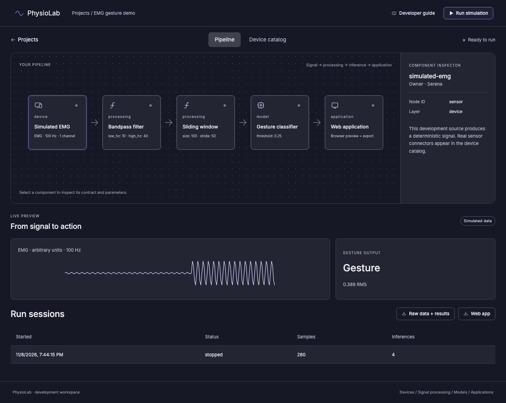

# PhysioLab

A no-code physiological app builder, developed alongside the original PhysioLabXR desktop app.
This directory is the new platform. The existing `../physiolabxr/` code remains the source for
sensor connector migration. Start here if you are Serena, Haosen or Marvin.

## Run it

Prerequisites: Python 3.12+, [uv](https://docs.astral.sh/uv/getting-started/installation/),
Node 22.12+ and npm. No device, API key, LLM account, Qt installation or cloud deployment is required.
On Windows use WSL, or run `uv sync --directory backend --frozen`, `npm ci --prefix web`
and `python scripts/dev.py` from this directory instead of Make.

```sh
git clone https://github.com/PhysioLabXR/PhysioLabXR-Community.git
cd PhysioLabXR-Community
git switch feat/physiolab-platform-skeleton
cd physiolab
make setup
make dev
```

Open **http://127.0.0.1:5178**. API docs: **http://127.0.0.1:8008/docs**.
Create a project → inspect a node → save a parameter → Run simulation → Stop run → export
raw data/results or the standalone web app. The signal alternates rest and activation every
two seconds. Sessions stop automatically after 60 seconds. Projects and recordings survive
restarts in `backend/.data/`. Ctrl-C shuts down both services.

The prompt is saved as intent; the starter uses an explicit EMG template. The simulated
classifier is an RMS baseline, not a foundation model or a validated focus estimate.
Only the simulation executes today. Planned connectors are visibly marked in the catalog.



## Pick up your component

| Owner | Start in | First deliverable |
| --- | --- | --- |
| **Serena (Xinyue Xia)** | `backend/src/physiolab/devices/` | Device capability inventory and first real sensor stream; Apple Watch and Oura in scope |
| **Haosen Zhang** | `backend/src/physiolab/processing/`, `models/` | Validated signal modules, model review and first open-source model adapter |
| **Marvin Zhong** | `backend/src/physiolab/orchestration/`, `applications/`, `web/src/` | Ten prompts/golden pipelines, generation agent and deployable app targets |

Read [HANDOFF.md](docs/HANDOFF.md) for ownership, interface rules, acceptance criteria and
meeting decisions. [ARCHITECTURE.md](docs/ARCHITECTURE.md) describes the extension seams.
The team's actionable work is tracked in [Linear PHY](https://linear.app/physiolab/team/PHY/active).
[BACKLOG.md](docs/BACKLOG.md) is the checked-in handoff reference; Linear is the live task tracker.

## What is here

- Python/FastAPI API with typed Pydantic contracts and generated TypeScript bindings.
- Deterministic device → stateful bandpass → sliding window → EMG model → application path.
- Project/parameter persistence, bounded background sessions, raw recording and exports.
- React/TypeScript builder with pipeline inspection, device catalog, waveform and session history.
- Adapter for legacy channel-major device outputs with explicit clock conversion.
- Imported design reference under `design/`, with its assets and runtime preserved.
- Dockerfile, a Render blueprint template, locked dependencies, CI and browser smoke coverage.

## Validate a change

```sh
make check
make schema                         # after changing API contracts
cd web
npx playwright install chromium     # once per machine
npm run test:e2e
```

The browser test starts its own API/frontend when those ports are free. It uses a separate
`physiolab/.data/e2e` data directory. Stop `make dev` before testing for an isolated run.
To view the imported prototype: `python3 -m http.server 8098 --directory design`, then open
`http://127.0.0.1:8098/PhysioLab%20Builder.dc.html`. Its original runtime loads React, fonts,
icons and XR libraries from CDNs; the new builder uses installed packages.

## Deployment boundary

Build with `docker build -t physiolab-demo physiolab` from the repo root; run with
`docker run --rm -p 8000:8000 physiolab-demo`. The `render.yaml` template deploys this same
simulation as one service, not the meeting's future per-request worker architecture.
No live Render services are provisioned by setup. This is a local, single-process development
service with no user authentication. Before public multi-user use: implement auth, tenant
storage, credential handling, isolated jobs and quotas from the Linear backlog.
