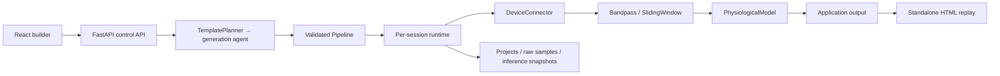

# Architecture and contracts

The Nov 8 meeting calls for four layers: devices, signal processing, physiological models,
and applications. A planner assembles these into a pipeline. Python is retained for the
signal/model ecosystem and existing connector code; React/TypeScript supplies a maintainable
web builder derived from the imported design. This stack choice is a scaffold implementation
decision, not a verbatim meeting decision.

## Component boundaries

| Boundary | Contract | Owner |
| --- | --- | --- |
| Connector → processing | `StreamDescriptor`, `SampleBatch`, `DeviceConnector` | Serena |
| Processing → model | Sample-major windows with timestamps and units | Haosen |
| Model → application | `Inference`; add model-specific typed outputs when needed | Haosen + Marvin |
| Planner → runtime | Versioned `Pipeline` (`Node`, `Edge`) validated before execution | Marvin |
| API → web | `docs/openapi.json` → `web/src/lib/schema.d.ts` | Shared |
| Project → deployment | `DeploymentProvider`; local HTML export is implemented | Marvin |

`contracts.py` is authoritative. Run `make schema` and commit both generated artifacts with
contract changes. Reject unknown fields/implementations instead of accepting a graph that
cannot run. The initial runtime supports a single five-node chain; arbitrary branching,
fan-in, modalities and model outputs belong in deliberate contract extensions with tests.

Samples are **samples × channels**; each row has a Unix-seconds timestamp. Channel names,
units, nominal rate and delivery mode travel with the data. Irregular/batch sources can
leave the nominal rate null; processors must require or derive a rate explicitly. Model
outputs use generic labels, numeric values and units so new tasks do not need an EMG label enum. Each connector must document
its actual clock and how it maps to Unix time. `LegacyDeviceAdapter` converts the old
**channels × samples** result and requires a clock converter. Do not infer live availability
from an advertised sampling rate or disguise Oura synchronization as live streaming.

## Runtime and persistence

Each run snapshots its pipeline, creates its own filter/window/model state, records raw
batches and model results, and closes its source on stop, failure, shutdown or the 60-second
limit. One project has at most one active run; the development process permits four runs.
Atomic file replacement keeps reads consistent. Interrupted records are marked on startup.
This is intentionally one process/worker. Do not scale it to multiple workers with local JSON
storage; replace storage and job ownership first. Full session responses are bounded for
this demo; use paginated metadata + streaming chunks for production recordings.

No arbitrary Python or generated code is executed. The planner interface is currently an
explicit template, and the catalog lists only one runnable model. No unavailable foundation
model is advertised. LLM agents must emit validated contracts and constrained parameters.

## Existing code to reuse

- `../../physiolabxr/interfaces/DeviceInterface/DeviceInterface.py`: lifecycle and channel-major output.
- `../../physiolabxr/interfaces/LSLInletInterface.py`: LSL inlet behavior and disconnect semantics.
- `../../physiolabxr/interfaces/OpenBCIDeviceInterface.py`: OpenBCI/BrainFlow starting point.
- `../../physiolabxr/interfaces/DeviceInterface/`: DSI24, Tobii, BAlert and Unicorn examples.

Keep native SDK/Qt imports in a device-side bridge; the Render runtime cannot reach a user's
local BLE/USB devices directly. The bridge must authenticate, timestamp and transport data.
Legacy hardware adapters are not validated by the simulation tests.

## Frontend mapping from the imported prototype

`PipelineCanvas` owns graph presentation; `Inspector` owns parameter editing;
`SessionPanel` owns waveforms, inference, recordings and exports; `App` coordinates project
navigation/API state. `theme.css` is a formatted copy of the imported Nocturne token sheet.
The complete original prototype is under `design/`; it includes future device pairing,
model switching, voice interaction and phone/XR/dashboard experiences. Those prototype
animations are design references, not implemented hardware/model/deployment capabilities.

## Render path

The blueprint builds a single Docker service containing API and web assets. The meeting's
per-user-request instance architecture needs a control plane, worker provisioning adapter,
job state, cancellation, teardown, budgets, secrets and tenant isolation. Keep the current
`DeploymentProvider` seam; implement this as a reviewed adapter rather than starting paid
instances from a default local demo. Free-service files are ephemeral.

References: [FastAPI modular applications](https://fastapi.tiangolo.com/tutorial/bigger-applications/),
[Vite guide](https://vite.dev/guide/), [Render Blueprint schema](https://render.com/docs/blueprint-spec),
[Oura V2 documentation](https://cloud.ouraring.com/v2/docs).
